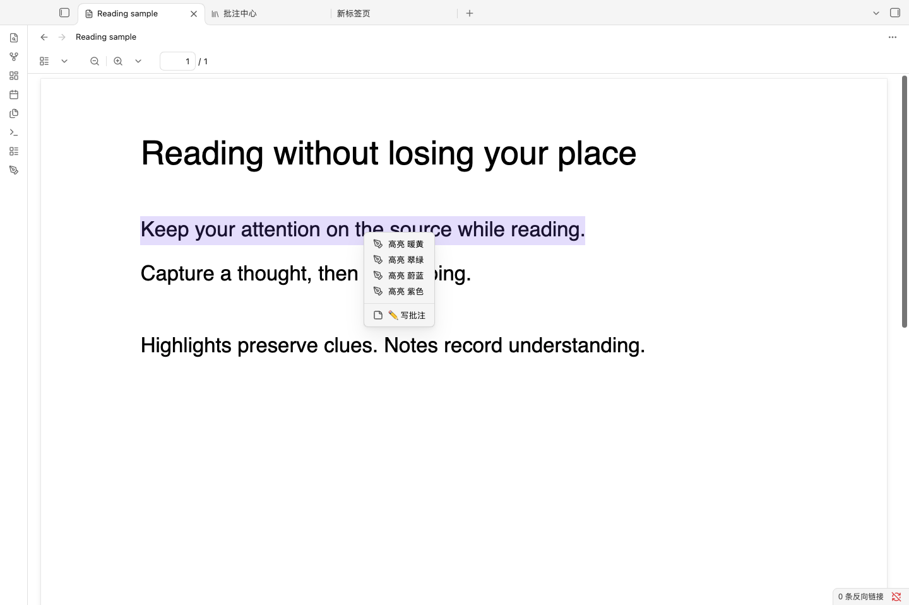
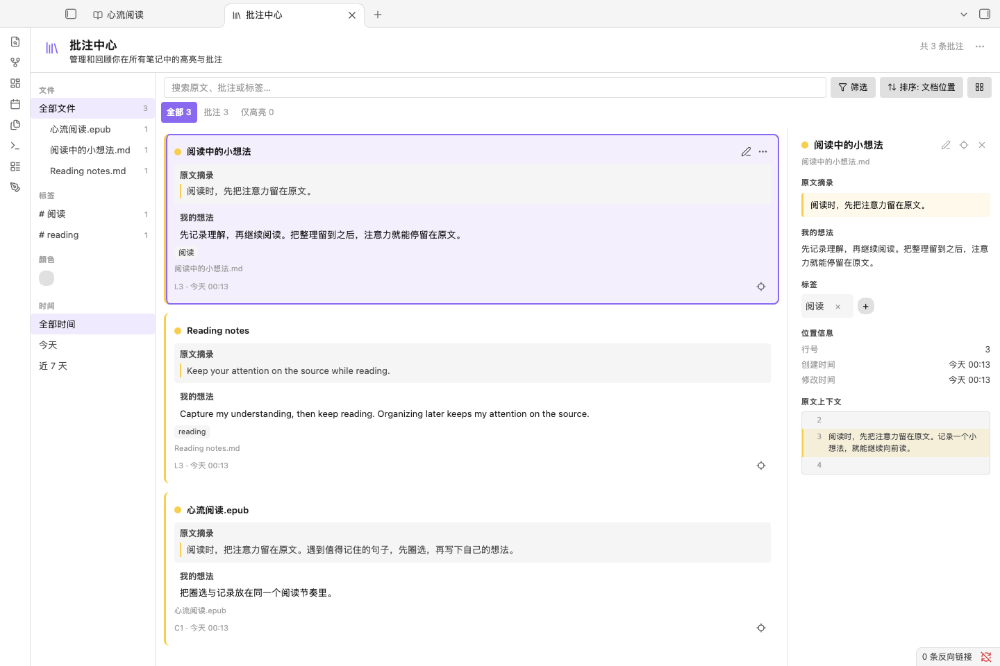

# Scholiast · 笺注

在 Obsidian 里读 Markdown、PDF 和电子书：在原文上高亮、写想法，不用切窗口，原文不被改动。

Read Markdown, PDF and ebooks in Obsidian — highlight and note in place, without the mouse, keeping the original file untouched.

> 使用手册版本 **0.9.2**。最低 Obsidian 版本 **1.13.0**。

**30 秒了解**

- **就地记录**：选文或光标停在句子上，一条命令高亮或写想法，不新建笔记，不插标记。
- **键盘优先**：Markdown 光标即范围；PDF 与电子书按一下激活键、输字母标签圈选。鼠标也全程可用。
- **先记后理**：分组、筛选、导出留给阅读之后。
- **原文不动**：批注存在知识库 `scholiast/` 的 JSON 里，可随库同步；不依赖网络。

## English guide

Scholiast keeps you reading: capture a thought where you are, without switching windows or touching the original file.

- **Install**: download `main.js`, `manifest.json`, `styles.css` from [releases](https://github.com/github-oysl/obsidian-annotation-plugin/releases) into `.obsidian/plugins/scholiast/`, then enable **Scholiast**. Keep `data.json` and the vault's `scholiast/` folder when updating.
- **Markdown**: place the cursor on a sentence, heading or code line (or select text), run **Add note to current selection** or **Highlight current selection (default color)**, save with `Enter` / `Ctrl+Enter`.
- **Ebooks & PDF**: enable **keyboard selection** once in Settings → Scholiast. Press the activation key to show labels, type a label to pick a start, extend with Left/Right, `Enter` writes a note. PDF page and region notes work from the command palette.
- **Review**: the pen ribbon or **Toggle annotation panel** shows the current document; **Open annotation library** reviews across documents. Exports are one-way Markdown snapshots.
- **Data**: annotations in `scholiast/annotations.json`, reading state in `scholiast/reading-state.json`, settings in `data.json`. No account, no network, originals never modified.

The full bilingual guide continues below. Report issues with plugin/Obsidian version, OS and steps in the [source issue tracker](https://github.com/github-oysl/obsidian-annotation-plugin-src/issues).

## 安装与更新

1. 从[分发仓库 Releases](https://github.com/github-oysl/obsidian-annotation-plugin/releases) 下载 `main.js`、`manifest.json`、`styles.css`。
2. 在知识库配置目录创建 `plugins/scholiast/`（常见为 `.obsidian/plugins/scholiast/`），放入三个文件。
3. 在 **设置 → 社区插件** 启用 **Scholiast**。更新时替换三个文件并重新加载，保留 `data.json` 与 `scholiast/` 数据目录。

阅读引擎离线内嵌，不需要 calibre、账户或转换服务。

## 快速上手

**Markdown**：光标停在句子、标题或代码行上（也可先选文）→ 命令面板运行 `给当前选中写批注` 或 `高亮当前选中（默认颜色）` → `Enter` / `Ctrl+Enter` 保存。

**电子书**：`设置 → Scholiast` 开启键盘圈选（默认关闭）→ 聚焦正文按一下激活键（默认 Space，macOS 新装默认反引号）→ 输标签选起点 → 左右键逐句调终点 → `Enter` 写想法。

**PDF**：同开关。聚焦页面，方向键翻页 → 按激活键输文字块/句标签 → 松键保留范围 → `Enter` 写想法。扫描页用 `给 PDF 页面写想法` / `给 PDF 区域写想法`。

## 推荐快捷键

命令出厂不带默认热键，在 **设置 → 快捷键** 自行绑定。一套 Mac 起点：**⌘⇧E** 编辑光标处批注、**⌘⇧L** 侧栏定位、**⌘⇧⌫** 删除、**⌘⇧H** 快速高亮、**⌘⇧N** 给选中写批注。电子书的激活键不要再分给别人。

| 命令 | 用途 |
| --- | --- |
| 给当前选中写批注 | 记下想法 |
| 高亮当前选中（默认颜色） | 快速高亮 |
| 编辑光标处批注 | 免选中改最近一条 |
| 删除批注（光标 / 选择 / 可见页） | 免选中删除 |
| 切换批注面板 | 回看当前文档 |
| 撤销上次批注操作 | 记错可撤 |

## 三种格式怎么批注

| 格式 | 怎么做 |
| --- | --- |
| Markdown | 选中文字，或只放光标让命令推断范围；工具条与命令面板都能高亮、写想法 |
| PDF | 键盘标签圈选或右键菜单；范围限同一页；扫描页用页面/区域想法 |
| EPUB / MOBI / AZW3 / FB2 | 内置阅读器打开未加密文件；色板或铅笔批注，可开键盘圈选 |

## 圈选与编辑细节

**电子书圈选**：按一下激活键进入、再按退出（默认单击切换；设置可改回长按）→ 输段落/句子标签选起点 → 左右键逐句调终点，同章跨页跟随 → `Enter` 写想法、`⌘↩` 存纯高亮、`E` 编辑已有批注、`Esc` 取消。设置里可开「Enter 直接存高亮」快速模式。松键不保存；`Backspace` 回上一层。

**PDF 圈选**：按住激活键 → 输块/句标签 → 松键保留范围 → 左右键调同页终点 → `Enter` 写想法、`Ctrl+Enter` 直接高亮。未圈选时方向键翻物理页；扫描页页面/区域想法不要求开圈选。

**编辑弹窗**：摘录、想法、标签、色板共用。`⌘S`/`Ctrl+S` 保存；`Esc` 草稿有改动先确认；点外部有变化才存。可选「输入中 Tab 换色」「Enter 直接保存」。

**删除与撤销**：`删除批注（光标 / 选择 / 可见页）` 有明确目标直接删；无目标按可见页取候选，一条直接删、多条输标签删。三种阅读器共用 `Ctrl/Cmd+Z` 撤销、`Ctrl/Cmd+Y` 或 `Ctrl/Cmd+Shift+Z` 重做；输入框与 Markdown 源码保留文字历史。

## 回顾与整理

侧栏笔形图标或 `切换批注面板` 看当前文档；`打开批注中心` 跨文档回顾。卡片分**原文摘录**与**我的想法**，支持搜索、颜色/标签/文件筛选与排序。点卡片回原文；铅笔编辑；更多菜单可复制摘录、精确链接、改色、重新指定、转独立笔记。

导出与独立笔记是**单向快照**：按原文分组排序，含摘录、想法、标签、颜色名、位置和精确链接；改它们不写回批注。需要原生双链标签，在导出的 Markdown 里自己加。

## 数据与隐私

- 批注、文档身份、分组存 `scholiast/annotations.json`；阅读位置、最近阅读、面板开关存 `scholiast/reading-state.json`；设置存插件 `data.json`。
- 备份包含原文件与两个 JSON。多设备纳入同步，避免两台设备同时编辑。
- 阅读与批注不依赖网络；书内脚本与外部资源被阻止；无云账户，不自动合并冲突。
- 库内改名/移动保留身份与批注；删除保留记录并标记缺失。换版后失联可在卡片菜单 **重新指定**，或对缺失文件 **重新关联缺失文档**。

## 使用边界

- 键盘圈选默认关闭；范围：电子书限同章，PDF 限同一物理页。复杂多栏、旋转、扫描页按块降级或用页面/区域想法。
- 电子书仅未加密文件，单文件 ≤ 100 MiB；不支持 DRM 与格式转换。
- 批注不自动进 Backlinks/Graph；导出的 Markdown 快照才参与双链。
- 移动端快捷按钮提供 Markdown 高亮/想法/面板入口；移动端电子书待验收。

## 常见问题

- **文件列表找不到电子书**：启用宿主「显示所有类型文件」，或用阅读/导入命令。
- **高亮失联**：原文可能变了；摘录与想法仍在，选中正确原文后 **重新指定**。
- **扫描 PDF 不能选文**：改用页面或区域想法；不支持跨页选区。
- **电子书打不开**：仅支持未加密、≤ 100 MiB 的文件。
- **快捷键在 EPUB 里没反应**：用 `⌘Q` 完全重启 Obsidian，确认 `manifest.version` 与磁盘一致。

更多命令与设置以插件内命令面板、**设置 → Scholiast**、**设置 → 快捷键** 为准。问题反馈请附插件/Obsidian 版本、系统与复现步骤：[源码问题区](https://github.com/github-oysl/obsidian-annotation-plugin-src/issues)。

## License / 许可

[MIT](LICENSE) · [Source / 源码](https://github.com/github-oysl/obsidian-annotation-plugin-src) · [开发文档](https://github.com/github-oysl/obsidian-annotation-plugin-src/blob/main/docs/README.md)
